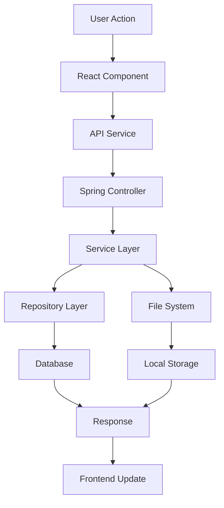

# Design Document

## Overview

O Sistema de Arquivos e Pastas (Explorer) é um explorador de arquivos web integrado ao SecuredGuard que permite aos usuários navegar, criar, mover, editar e gerenciar arquivos e diretórios com controle de permissões e segurança. O sistema utiliza uma arquitetura baseada em Spring Boot no backend e React.js no frontend, seguindo os padrões já estabelecidos no projeto.

**Observação Importante:** O sistema já possui uma implementação básica do backend com algumas funcionalidades implementadas. Este design irá expandir e completar as funcionalidades existentes, especialmente no frontend e nas funcionalidades avançadas do backend.

## Architecture

### Backend Architecture (Spring Boot)

O backend segue a arquitetura em camadas já estabelecida no projeto:

```
Controller Layer (FileSystemController) 
    ↓
Service Layer (FileSystemService)
    ↓
Repository Layer (FileSystemRepository)
    ↓
Database Layer (PostgreSQL)
    ↓
File System Layer (Local Storage)
```

### Frontend Architecture (React.js)

O frontend seguirá a arquitetura de componentes React já estabelecida:

```
Pages/
├── FileExplorer/
│   ├── FileExplorerPage.tsx (Main container)
│   └── components/
│       ├── FileTree.tsx (Left panel - folder tree)
│       ├── FileGrid.tsx (Right panel - file/folder grid)
│       ├── FileToolbar.tsx (Top toolbar with actions)
│       ├── FileUpload.tsx (Upload component with drag & drop)
│       ├── FileContextMenu.tsx (Right-click context menu)
│       ├── CreateFolderModal.tsx (Modal for creating folders)
│       ├── RenameModal.tsx (Modal for renaming items)
│       └── FilePreview.tsx (File preview component)
```

### Data Flow



## Components and Interfaces

### Backend Components

#### 1. FileSystemController (Existing - Needs Enhancement)
**Status:** Parcialmente implementado
**Enhancements Needed:**
- Implementar funcionalidade de mover arquivos/pastas
- Implementar busca de arquivos
- Implementar obtenção de informações detalhadas de itens
- Adicionar validação de permissões mais robusta

#### 2. FileSystemService (Existing - Needs Enhancement)
**Status:** Implementado com funcionalidades básicas
**Enhancements Needed:**
- Implementar moveItem() method
- Implementar searchFiles() method
- Implementar getItemInfo() method
- Adicionar suporte a operações em lote
- Melhorar tratamento de erros

#### 3. FileSystemRepository (Existing)
**Status:** Implementado
**Additional Methods Needed:**
```java
List<FileSystemItem> findByOwnerAndNameContainingIgnoreCase(User owner, String name);
List<FileSystemItem> findByParentAndNotDeleted(FileSystemItem parent);
Optional<FileSystemItem> findByOwnerAndFullPath(User owner, String fullPath);
```

### Frontend Components

#### 1. FileExplorerPage (New)
**Purpose:** Main container component that manages the overall state and layout
**Props:** None (route-based)
**State:**
- currentPath: string
- selectedItems: FileSystemItem[]
- isLoading: boolean
- files: FileSystemItem[]
- folders: FileSystemItem[]

#### 2. FileTree (New)
**Purpose:** Left panel showing folder hierarchy
**Props:**
- folders: FileSystemItem[]
- currentPath: string
- onFolderSelect: (path: string) => void
- onFolderExpand: (folderId: string) => void

#### 3. FileGrid (New)
**Purpose:** Right panel showing files and folders in grid/list view
**Props:**
- items: FileSystemItem[]
- selectedItems: FileSystemItem[]
- onItemSelect: (item: FileSystemItem) => void
- onItemDoubleClick: (item: FileSystemItem) => void
- viewMode: 'grid' | 'list'

#### 4. FileToolbar (New)
**Purpose:** Top toolbar with action buttons
**Props:**
- selectedItems: FileSystemItem[]
- onUpload: () => void
- onCreateFolder: () => void
- onDelete: () => void
- onRename: () => void
- onDownload: () => void

#### 5. FileUpload (New)
**Purpose:** Drag & drop upload component
**Props:**
- currentPath: string
- onUploadComplete: (files: FileSystemItem[]) => void
- maxFileSize: number
- acceptedTypes: string[]

## Data Models

### Existing Models (Already Implemented)

#### FileSystemItem Entity
```java
@Entity
@Table(name = "file_system_items")
public class FileSystemItem {
    @Id
    @GeneratedValue(strategy = GenerationType.UUID)
    private UUID id;
    
    @Column(nullable = false)
    private String name;
    
    @Column(nullable = false)
    private String path;
    
    @Enumerated(EnumType.STRING)
    private ItemType type; // FILE, FOLDER
    
    private Long size;
    private String mimeType;
    private String fileExtension;
    
    @ManyToOne
    private FileSystemItem parent;
    
    @ManyToOne(nullable = false)
    private User owner;
    
    @Builder.Default
    private Boolean isDeleted = false;
    
    private LocalDateTime createdAt;
    private LocalDateTime modifiedAt;
    private String physicalPath;
}
```

### Frontend Models

#### FileSystemItem Interface
```typescript
interface FileSystemItem {
  id: string;
  name: string;
  path: string;
  type: 'FILE' | 'FOLDER';
  size?: number;
  mimeType?: string;
  fileExtension?: string;
  parentId?: string;
  ownerId: string;
  isDeleted: boolean;
  createdAt: string;
  modifiedAt: string;
  displaySize: string;
  fullPath: string;
}
```

#### FileSystemResponse Interface
```typescript
interface FileSystemResponse {
  success: boolean;
  message: string;
  data?: FileSystemItem | FileSystemItem[];
  error?: string;
}
```

### API Request/Response Models

#### CreateFolderRequest (Existing)
```java
public class CreateFolderRequest {
    @NotBlank
    private String name;
    
    @NotNull
    private String parentPath;
}
```

#### UploadFileRequest (New)
```java
public class UploadFileRequest {
    @NotNull
    private MultipartFile file;
    
    @NotNull
    private String parentPath;
    
    private String description;
}
```

#### MoveItemRequest (Existing - Needs Implementation)
```java
public class MoveItemRequest {
    @NotBlank
    private String targetPath;
}
```

## Error Handling

### Backend Error Handling
- **FileNotFoundException:** Quando arquivo/pasta não é encontrado
- **AccessDeniedException:** Quando usuário não tem permissão
- **DuplicateNameException:** Quando nome já existe no diretório
- **StorageException:** Quando há problemas no sistema de arquivos
- **FileSizeException:** Quando arquivo excede limite de tamanho

### Frontend Error Handling
- Toast notifications para erros de operação
- Loading states durante operações
- Retry mechanisms para falhas de rede
- Validation feedback em formulários

## Testing Strategy

### Backend Testing

#### Unit Tests
- **FileSystemServiceTest:** Testar todas as operações CRUD
- **FileSystemControllerTest:** Testar endpoints e validações
- **FileSystemRepositoryTest:** Testar queries customizadas

#### Integration Tests
- **FileSystemIntegrationTest:** Testar fluxo completo de operações
- **FileUploadIntegrationTest:** Testar upload de arquivos grandes
- **PermissionIntegrationTest:** Testar controle de acesso

### Frontend Testing

#### Component Tests
- **FileTree.test.tsx:** Testar navegação e expansão de pastas
- **FileGrid.test.tsx:** Testar seleção e visualização de itens
- **FileUpload.test.tsx:** Testar drag & drop e upload

#### E2E Tests
- **file-explorer.e2e.ts:** Testar fluxo completo do usuário
- **file-operations.e2e.ts:** Testar operações de arquivo
- **permissions.e2e.ts:** Testar controle de permissões

### Performance Testing
- **Load Testing:** Testar com até 10.000 arquivos por diretório
- **Upload Testing:** Testar upload de arquivos até 100MB
- **Concurrent Access:** Testar múltiplos usuários simultâneos

## Security Considerations

### Authentication & Authorization
- JWT token validation em todas as operações
- Verificação de ownership de arquivos/pastas
- Role-based permissions (Admin, Editor, Viewer)
- Path traversal protection

### File Security
- Validação de tipos de arquivo permitidos
- Scan de malware em uploads (futuro)
- Sanitização de nomes de arquivo
- Limite de tamanho por arquivo e por usuário

### API Security
- Rate limiting em endpoints de upload
- CSRF protection
- Input validation e sanitização
- Audit logging de todas as operações

## Performance Optimizations

### Backend Optimizations
- Lazy loading de relacionamentos JPA
- Paginação para listagem de arquivos
- Cache de metadados de arquivos
- Async processing para uploads grandes

### Frontend Optimizations
- Virtual scrolling para listas grandes
- Lazy loading de thumbnails
- Debounced search
- Progressive loading de diretórios

### Storage Optimizations
- Estrutura de diretórios otimizada por usuário
- Cleanup de arquivos deletados (soft delete)
- Compressão de arquivos (futuro)
- CDN para arquivos estáticos (futuro)

## Implementation Phases

### Phase 1: Complete Backend Implementation
- Implementar funcionalidades faltantes no FileSystemService
- Adicionar validações robustas
- Implementar testes unitários
- Melhorar tratamento de erros

### Phase 2: Frontend Basic Implementation
- Criar componentes básicos do explorador
- Implementar navegação de pastas
- Implementar upload básico
- Integrar com APIs do backend

### Phase 3: Advanced Features
- Implementar drag & drop
- Adicionar context menus
- Implementar busca de arquivos
- Adicionar preview de arquivos

### Phase 4: Polish & Optimization
- Melhorar UX/UI
- Otimizar performance
- Adicionar testes E2E
- Implementar features avançadas

## Technical Decisions

### Storage Strategy
**Decision:** Local file system storage
**Rationale:** Simplicidade inicial, controle total, sem custos de cloud
**Future:** Migração para S3/Cloud Storage quando necessário

### Database Strategy
**Decision:** PostgreSQL com soft delete
**Rationale:** Consistência com o resto do sistema, auditoria, recuperação

### Frontend State Management
**Decision:** React hooks com Context API
**Rationale:** Simplicidade, sem overhead de Redux para este escopo

### File Upload Strategy
**Decision:** Multipart upload com progress tracking
**Rationale:** Melhor UX, suporte a arquivos grandes, feedback visual

## Monitoring and Logging

### Backend Monitoring
- Log de todas as operações de arquivo
- Métricas de uso de storage por usuário
- Performance metrics de operações
- Error tracking e alertas

### Frontend Monitoring
- User interaction tracking
- Performance metrics (load times)
- Error boundary logging
- Usage analytics

## Future Enhancements

### Version 2.0 Features
- Compartilhamento de arquivos/pastas
- Controle de versão de arquivos
- Colaboração em tempo real
- Preview avançado (PDF, Office docs)

### Version 3.0 Features
- Integração com cloud storage
- Sync offline/online
- Mobile app
- Advanced search com indexação de conteúdo